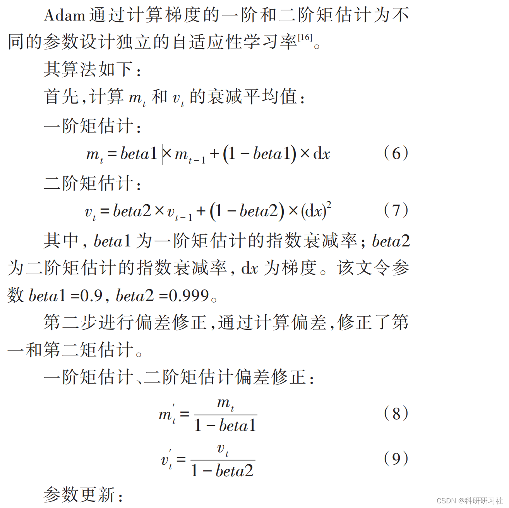
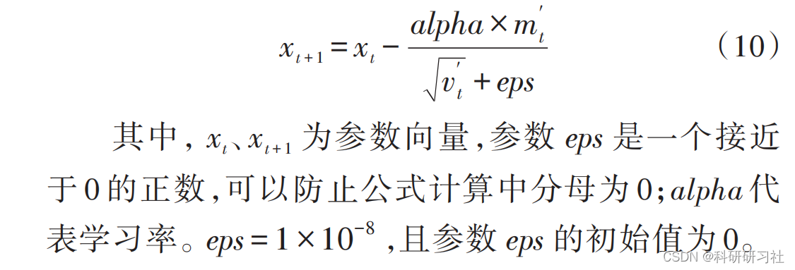
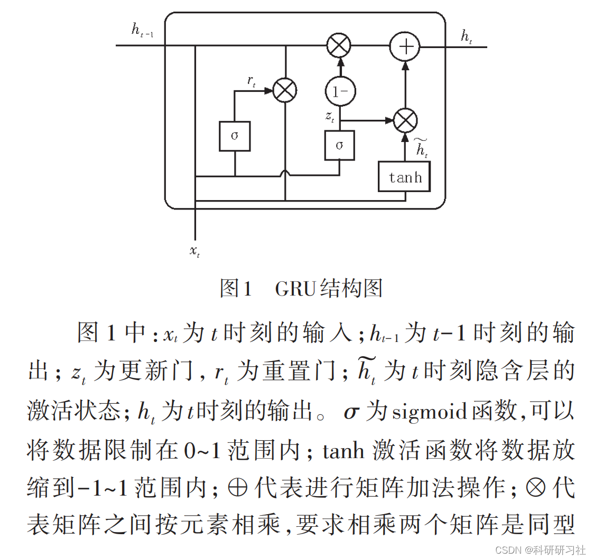
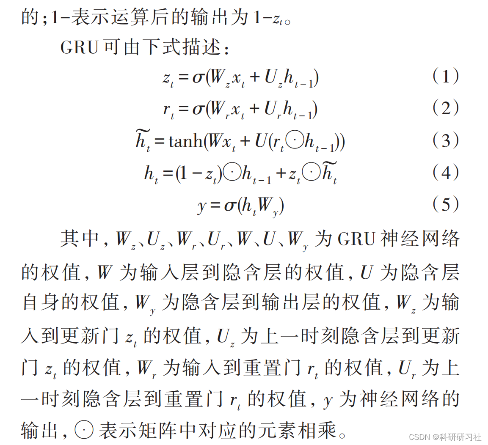
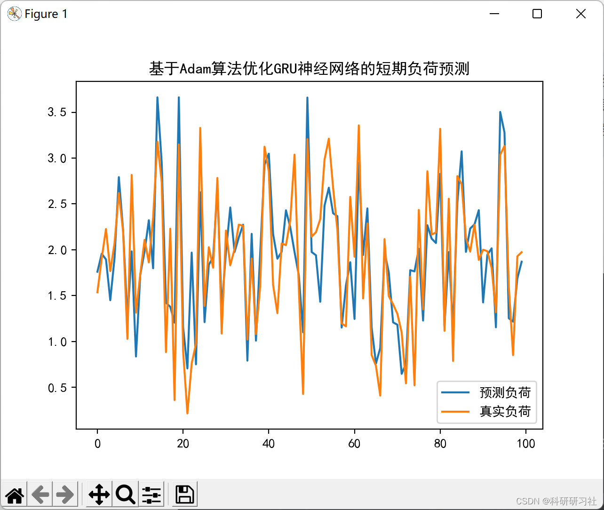
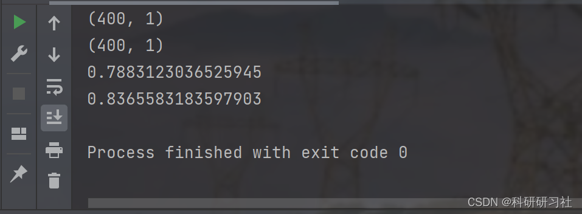
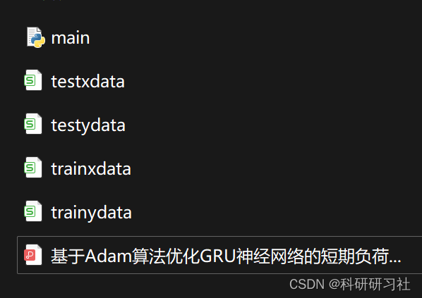

# Optimizing GRU Neural Network for Short-Term Load Forecasting Based on Adam Algorithm (Python Code Implementation)

​  
1. Adam optimization algorithm editor
Editor
2. Learning rate decay strategy in Adam algorithm This paper introduces the learning rate decay strategy based on the Adam algorithm. Parameters can be updated more quickly. Accelerate the convergence speed of the Adam algorithm in the early stages. And can improve the accuracy of the model. This article adopts a fractional attenuation method. The formula for score decay is:
Among them, epoch represents that all data in the sample set has undergone one training; decayrate is the rate of decay. In the text, parameter decayrate is mentioned.
te=1,epoch=1。  
As the number of iterations increases. The learning rate will decay in a score-based manner. Seek the global optimal solution through learning rate decay. The purpose of this method is to reduce the oscillations in the convergence curve during the iteration process. Improve the convergence speed and stability of the model. A global optimal solution is obtained.
To prevent the learning rate from decaying to zero when employing a learning rate decay strategy, set the minimum learning rate to 0.0005. During the algorithm iteration process, if the learning rate is less than 0.0005, the learning rate decay will not be applied again.
Adam optimization algorithm is an extension of stochastic gradient descent, which has been more widely adopted in deep learning applications in computer vision and natural language processing recently. Unlike the classic stochastic gradient descent, Adam maintains a single learning rate (called alpha) for all weight updates throughout training. The learning rate does not change during training. Each network weight (parameter) keeps its learning rate and adjusts separately as learning progresses. Adam recognizes the benefits of AdaGrad and RMSProp. Instead of adjusting the learning rate based on the average first moment (mean), Adam uses the second moment of the gradient's average at a particular time (without centered variance).Specifically, the algorithm calculates the exponential moving average of gradient and squared gradient, with parameters beta1 and beta2 controlling the decay rate of these moving averages. The initial values of the moving averages, as well as the values of beta1 and beta2 close to 1.0 (recommended), tend to bias the moment estimation value towards zero. This bias can be overcome by first calculating the bias estimate, then computing the bias-corrected estimate.
3 GRU Neural Network
GRU is proposed on the basis of LSTM neural network. The LSTM neural network consists of input gate, forgetting gate, and output gate.
GRU merges the forgetting gate and input gate into an update gate, and combines the memory unit with the hidden layer into a reset gate, thereby simplifying the structure's computation and enhancing its performance. The GRU structure is shown in Figure 1.
Editor
Editor
The conventional GRU neural network uses the stochastic gradient descent algorithm to iteratively update the weights of the neural network. This model has a slow convergence speed at the beginning, and it is prone to precision degradation issues. To improve prediction accuracy and accelerate the early convergence of the model, this article introduces the Adam optimization algorithm and incorporates a learning rate decay strategy to optimize the GRU neural network model. 4 Running Results
Editor
5 Python Code and Detailed Article
This article only showcases part of the code, all codes and detailed articles can be found in:
xtest = (xtest-xmean)/xstd\nZ1t = np.dot(wh, xtest.T) + bh\nA1t = sigmoid(Z1t)\nZ2t = np.dot(wo, A1t) + bo\nA2t = Z2t\nypredt = A2t.T\nypredt = ypredt*ystd+ymean\nerrort = ytest-ypredt\n\nplt.plot(ypredt,label='Forecast load')\nplt.plot(ytest,label='Real load')\nplt.title('Based onAdamAlgorithm optimizationGRUShort-term load forecasting of neural networks')\nplt.legend()\nplt.show()\n\n(Rt, pvalt) = stats.pearsonr(ytest.flatten(),ypredt.flatten())\nprint(Rt)\n  
6. References
[1] Gao Ao, Li Guoyu, Zhang Aoyang, Zhou Shengqi, Wei Zhen, and Zhang Zhisheng. Short-term load forecasting model based on Adam algorithm optimized GRU neural network [J]. Electronic Design Engineering, 2022, 30(09):180-183+188. DOI: 10.14022/j.issn1674-6236. 2022.09.038.

## Images

<!-- PAYMENT_BLOCK -->

## Get this dataset

- Payment link (Stripe): [Buy now](https://buy.stripe.com/3cs8yP7sY87d0vu9AB)
- Payment QR code: 

<!-- /PAYMENT_BLOCK -->
